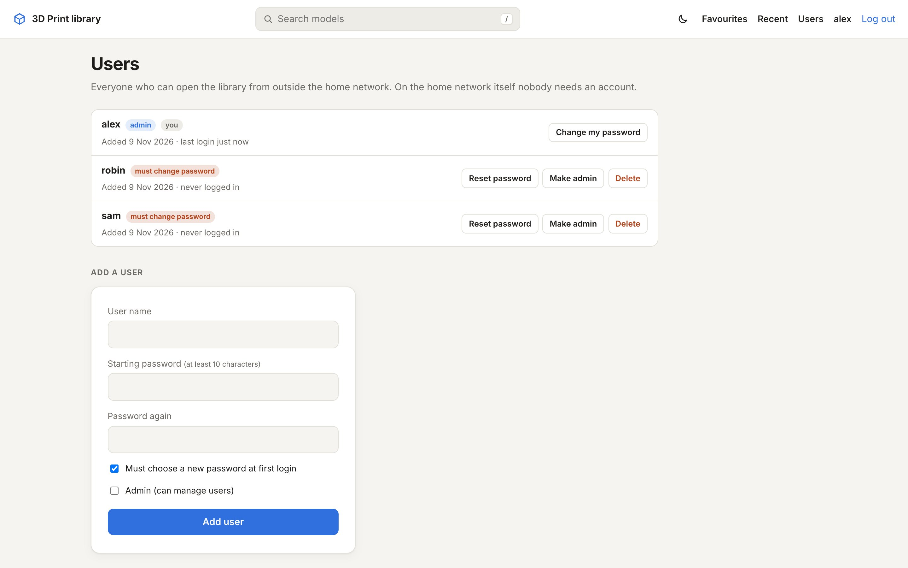
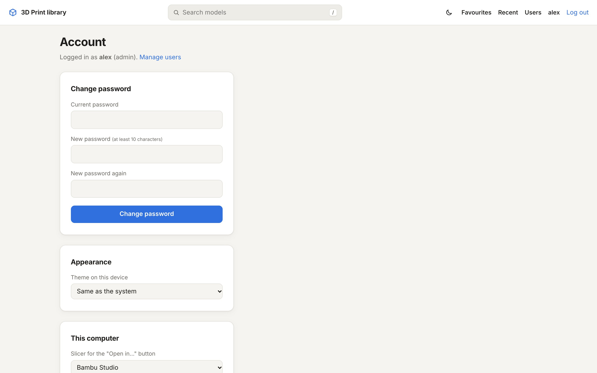

Accounts live in the site itself (in `data/users.db`), not in configuration files. There are two kinds: **admins**,
who manage the accounts, and everyone else. The [first account](/start/first-account/) is always an admin.

## Adding people

Admins see **Users** in the header. There you can add someone with a user name and a starting password. With
**Must choose a new password at first login** (on by default), they're asked to pick a new password right after
their first login, so you don't keep knowing it. Tick **Browse only** for someone who may look but not take files
(see below).

For each account you can also:

- **Set a new password**, optionally with **Must choose a new password at next login**. This logs them out
  everywhere.
- **Make admin** or **Remove admin**.
- **Browse only** or **Allow downloads** (not shown for admins, who can always download).
- **Delete** the account. This ends their sessions and removes their favourites.

The last admin can't be removed or deleted, so there's always someone who can manage accounts.

## Browse-only accounts

A browse-only account sees the whole library: folders, previews, photos, the 3D view, descriptions, print details,
search, Recent and its own favourites. It can't take files away:

- no **Download** buttons, no **Download folder** ZIP, and no download links for other files (images in a folder
  are still shown);
- no **Open in** button for the slicer.

The site refuses these downloads itself too, so a copied link doesn't work for a browse-only account either. The
change applies at once, without logging in again. A browse-only account shows a **browse only** label on the Users
page. Admins and visitors on the home network can always download.

## Your own account

Click your name in the header to open **Account**. There you change your password (this logs out your other devices)
and set what applies to this browser only: light or dark, which slicer the "Open in" button uses, and whether to open
the local copy.

## The home network

With `TRUSTED_NETWORKS` set, anyone who opens the site directly from that network is let in without a login, as
"Home network". They can do everything except manage accounts. Favourites starred this way are shared by everyone on
the home network.

Through a reverse proxy the login is always required, even from home. See
[Reverse proxy and HTTPS](/guides/reverse-proxy/).

## Sessions and limits

- Logins stay valid for 30 days with **Keep me logged in**, otherwise until the browser closes.
- Changing or resetting a password, and deleting an account, ends the sessions on other devices right away.
- After 8 wrong logins in 5 minutes from one address, that address has to wait a few minutes. Password changes are
  limited per account in the same way.
