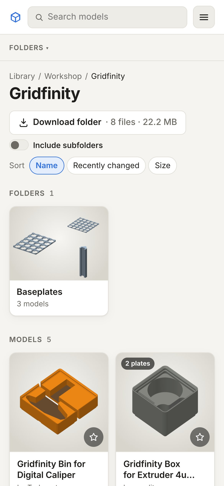
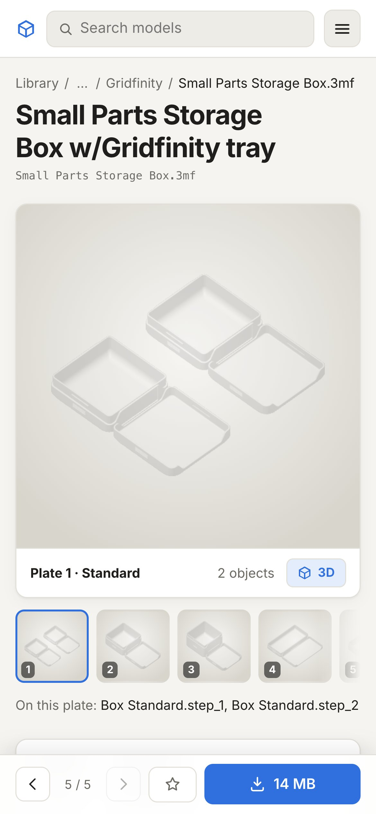
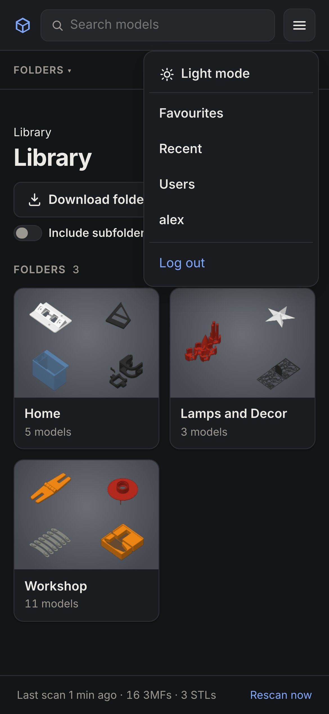

The site is made to work on a phone as well as on a big screen: one-row header with a menu, two cards per row, and on
a model's page the buttons stay at the bottom of the screen while you scroll through plates and photos.

## Install it as an app

The site can be added to your home screen, where it opens in its own window without the browser bars:

- **iPhone/iPad (Safari):** Share → **Add to Home Screen**.
- **Android (Chrome):** menu ⋮ → **Install app** (or **Add to Home screen**).
- **Desktop (Chrome, Edge):** the install icon at the right of the address bar.

It's still the website: it needs a connection to your server, and you log in the same way.

## What's different on a phone

- **Open in …** isn't shown: phones have no desktop slicer. Download the file and share it to your printer's app if it
  supports that.
- The 3D viewer works with touch: drag to rotate, pinch to zoom, two fingers to move.
- The plate strip scrolls sideways; long folder paths are shortened to "… / parent / folder" (tap the "…" for the full
  path).
