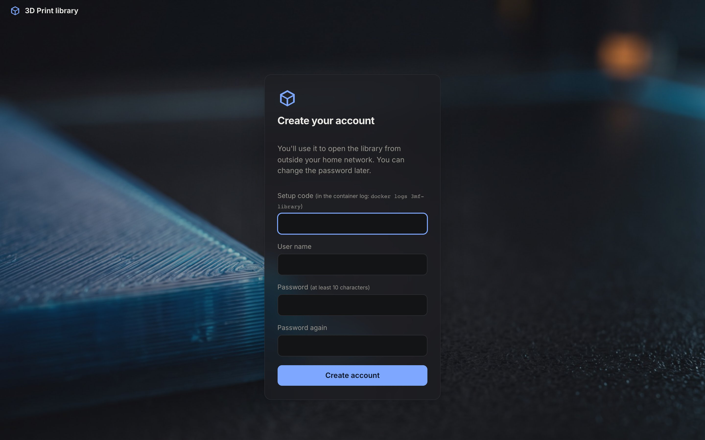

On a fresh installation the site asks you to create the first account. That account is an **admin**: it can add other
people later. How you get to that page depends on `TRUSTED_NETWORKS`.

## With a home network (`TRUSTED_NETWORKS` set)

Open the site from a computer on that network, **directly on its own address** (`http://<server>:8085`, not through a
reverse proxy). The setup page appears; choose a user name and a password of at least 10 characters.

From the home network you never need to log in; the account is for using the site away from home.

## Without a home network

Then anyone who reaches the site could open the setup page, so it asks for a **setup code** as well. The code is
printed in the container log when the site starts:

```bash
docker logs 3mf-library | grep "setup code"
```

```
No account yet. Open /setup and use this setup code to create the first (admin) account: K7MQ-2XWD
```

Only someone who can read the server's log has it. Upper or lower case and the dash don't matter.



## Through a proxy: never

The first account can't be created through a reverse proxy, even with a setup code. Open the site directly once, then
use the proxy for everything else.

## Lost access?

If you forgot the only admin's password: stop the container, delete `data/users.db`, start it again and set up a new
first account. This removes all accounts and favourites, but not the index or the previews. See
[Accounts and users](/guides/accounts/) for everything else.
