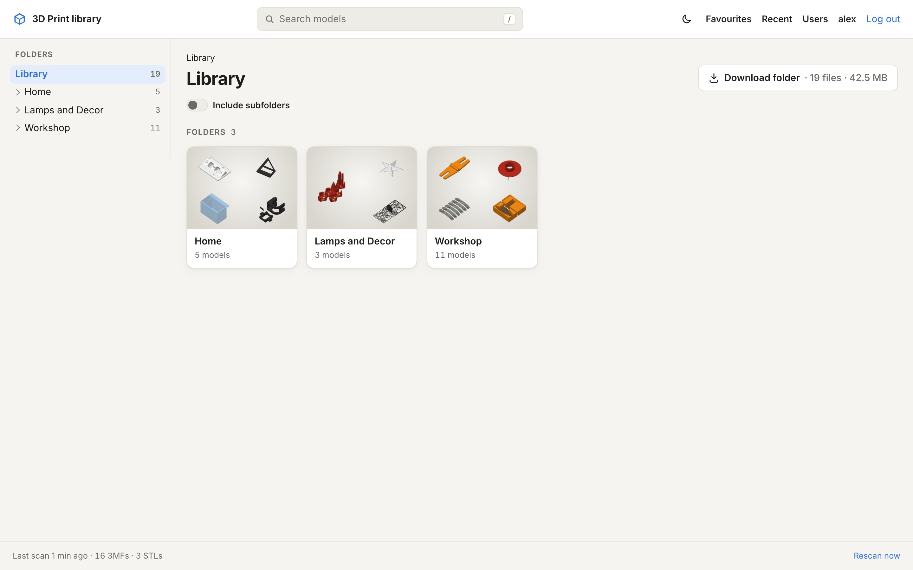

3MF Library is a self-hosted website for a folder of 3D print files. You point it at the folder where your 3MF and STL
files live, and it gives you a fast, good-looking way to browse, preview, search and print them, from any browser,
including your phone.

## What it does

- **Shows your folders exactly as they are on disk.** Every folder gets a tile with a mosaic of what's inside; every
  model gets a card with its preview, title, designer, colours and size.
- **Uses the previews that are already in your files.** Slicers store images of each plate in the 3MF; MakerWorld
  downloads also contain photos, a description, the designer and the licence. 3MF Library reads all of that. Only
  STLs and 3MFs without images get a rendered preview.
- **Gives every model its own page** with all plates, photos, the description, print time and filament per plate,
  and an interactive 3D view.
- **Finds things**: search across names, titles, designers, folders and part names, with sorting and a 3MF/STL filter.
- **Gets files to your printer**: download a file or a whole folder as ZIP, or open the model in your slicer directly.
- **Keeps working on its own**: it checks the folder every few minutes and picks up new, changed and removed files.

## What it doesn't do

- **It never changes your files.** The library is mounted read-only. There's no upload, rename, move or delete.
- **It doesn't reorganise anything.** No tags, collections or "projects": the folders are the organisation. If you
  want something in another place, move it in your file system or sync tool and the site follows.
- **It isn't a slicer or a print manager.** It hands files to your slicer; slicing and printing happen there.

## What you need

- A machine that runs Docker with Compose: a home server, a NAS that runs containers, a Raspberry Pi 4/5, a small VM.
  Images are published for **amd64** and **arm64**.
- Your models in a folder that machine can read: a local folder, or an NFS share from a NAS.
- A few hundred MB of memory for normal use. Opening very large models in the 3D viewer temporarily needs more; the
  container is capped at 3 GB by default.

Ready? Continue with the [quick start](/start/quick-start/), or pick the [installation guide for your
system](/install/overview/).
