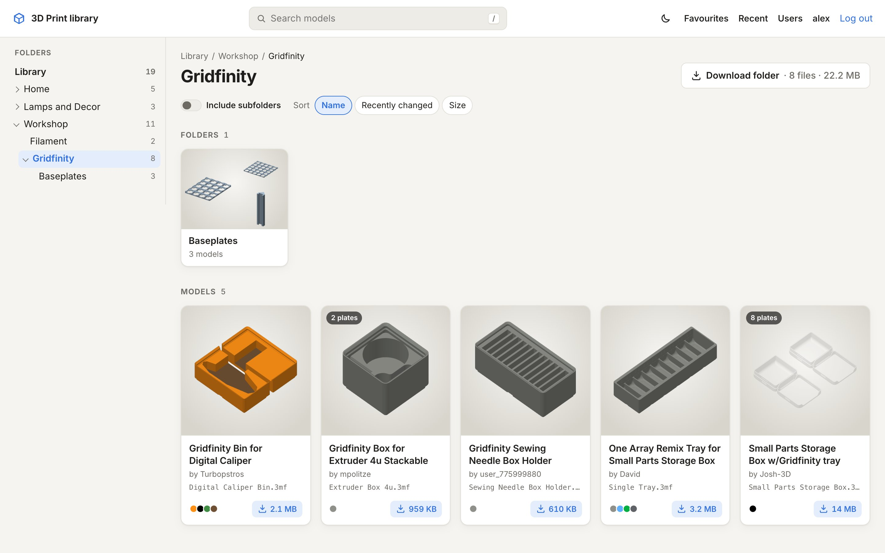
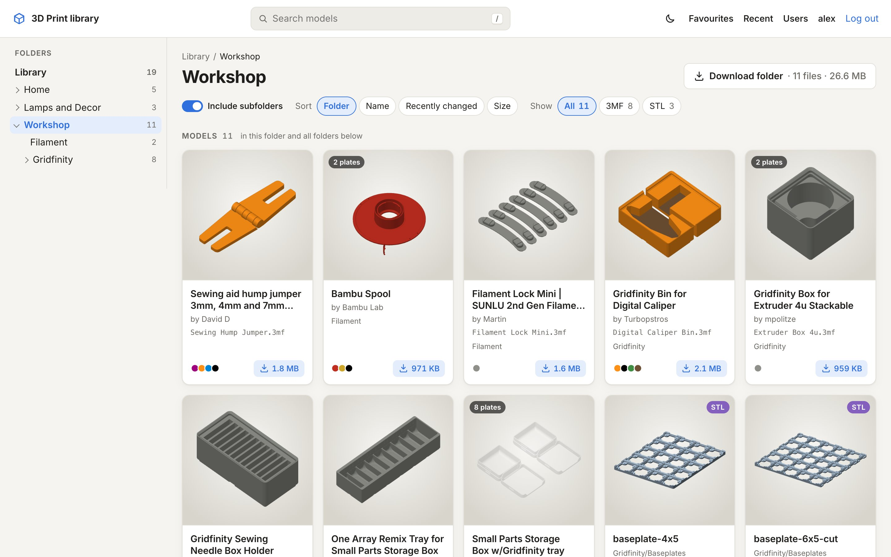
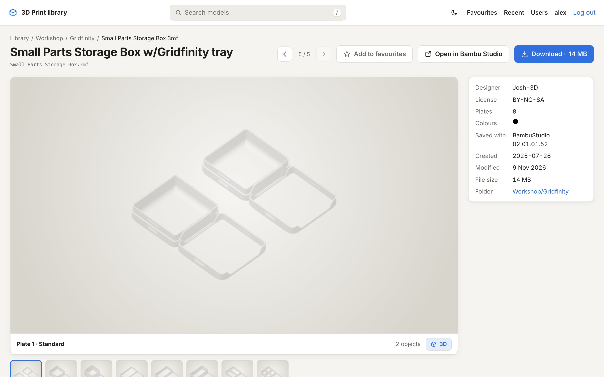
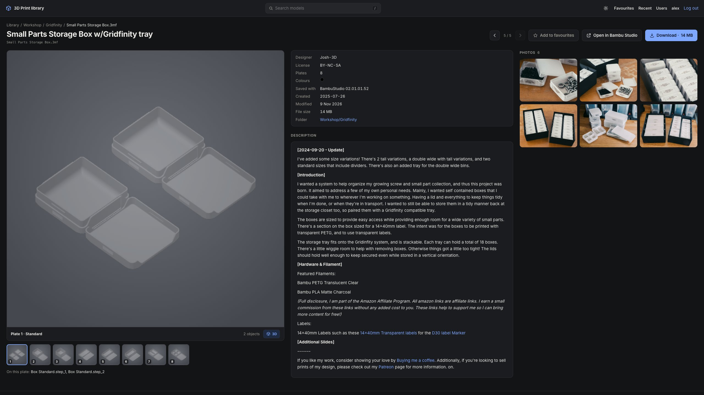
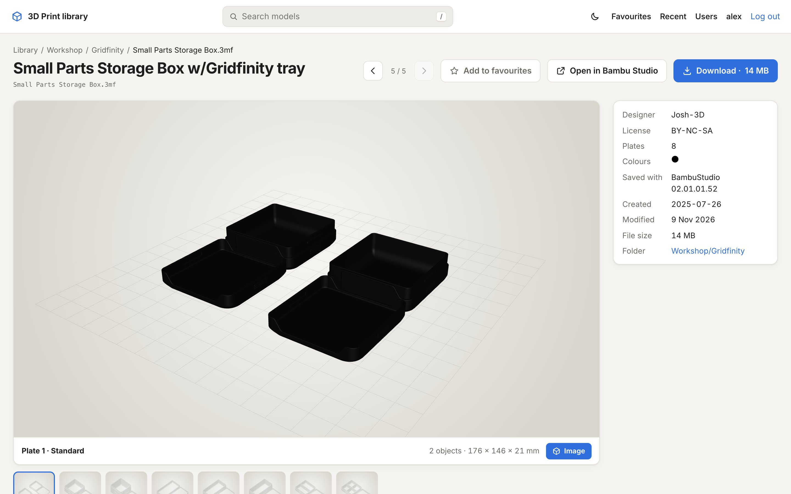
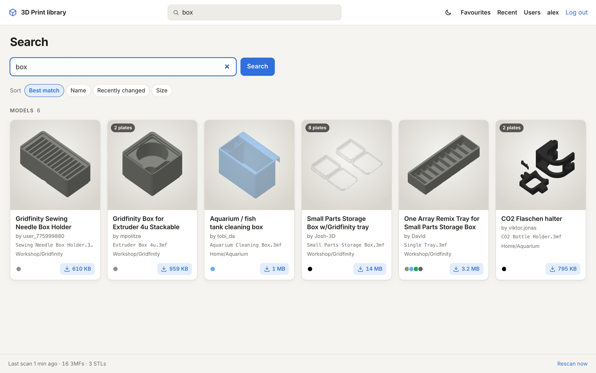
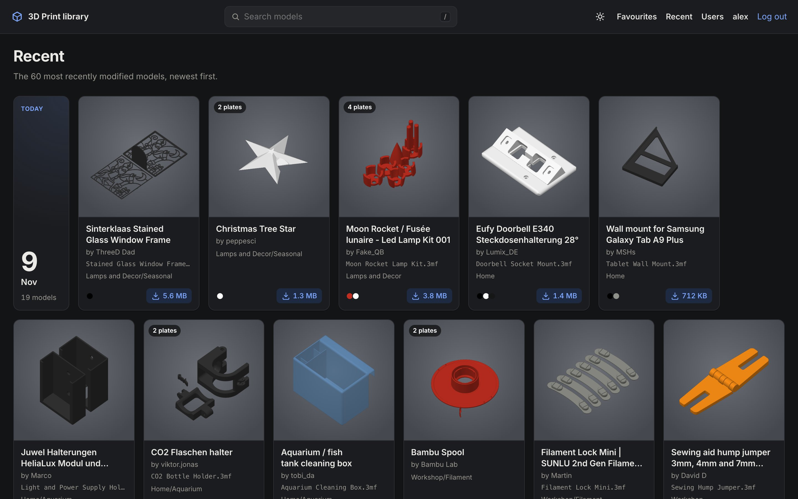
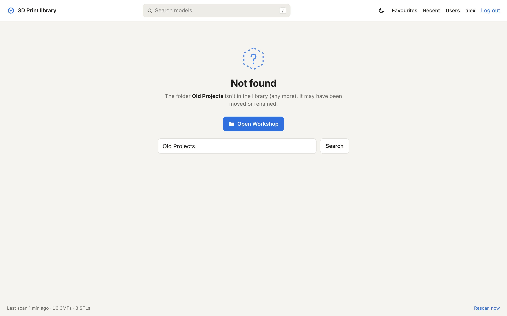

## Folders

The left column is your folder tree, with the number of models below each folder. A folder page shows its subfolders as
tiles (a mosaic of the first four previews inside) and its models as cards.

Each card shows the preview (the first plate), the number of plates, the title from the file (or the file name), the
designer, the filament colours and the size. Hover over a card to star it as a favourite; the size button downloads
the file.

Above the cards:

- **Include subfolders** shows every model below this folder in one grid, with the subfolder on each card. Handy for
  kits that are split over many folders.
- **Sort** by name, recently changed or size (and by folder when subfolders are included).
- **Show** all models, only 3MF or only STL, when a folder has both.
- **Download folder** gives you the whole folder, subfolders included, as one ZIP.

## A model's page

Click a card to open the model. You see the plate preview large, all plates underneath, and the details on the right:
designer, licence, plates, dimensions, print time and filament (as estimated when the file was saved), colours, the
slicer that saved it, and the folder.

Below that come the photos and the description that MakerWorld puts in its downloads. The buttons at the top:

- **← / →** go to the previous and next model in the same folder (the arrow keys do the same).
- **Add to favourites** stars the model.
- **Open in …** sends it to your slicer. See [Open in your slicer](/guides/slicers/).
- **Download** downloads the file.

On a wide screen the page uses three columns, so preview, details, description and photos fit side by side:

## The 3D viewer

The **3D** button below the preview swaps the image for an interactive model of the selected plate. Drag to rotate,
scroll or pinch to zoom, right-drag (or two fingers) to move. Picking another plate keeps the 3D view on that plate.
Very detailed models are simplified for the browser; the file you download is untouched.

## Search

The search box at the top searches file names, titles, designers, folder names and the names of the parts inside a 3MF.
Words match the start of a word: "lamp" finds "Lampshade", "shade" doesn't. Matching folders are listed first; models
can be sorted by best match, name, date or size, and filtered to 3MF or STL.

## Recent and favourites

**Recent** shows the 60 most recently changed models, grouped by day. **Favourites** shows what you starred. Favourites
are per account; everyone who uses the site from the home network without logging in shares one list.

## Light and dark

The site follows your device's light or dark setting. The moon/sun button in the header switches for this browser;
**Account → Appearance** goes back to following the system.

## Keyboard shortcuts

| Key | |
|---|---|
| `/` | Jump to the search box |
| `←` `→` | Previous / next model in the folder (on a model's page) |

## When something isn't there

Old links and models that were moved or renamed get a "Not found" page that points to the nearest folder that still
exists, with a search for the name already filled in.

